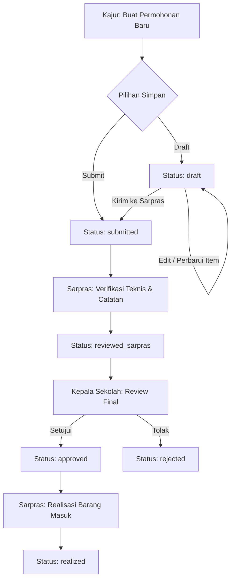
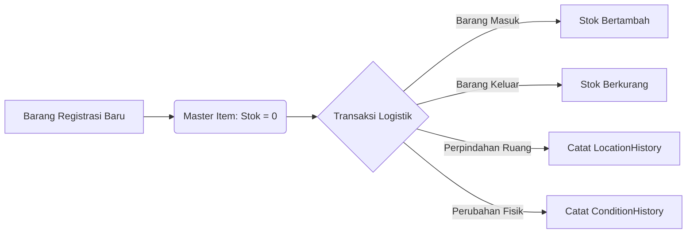
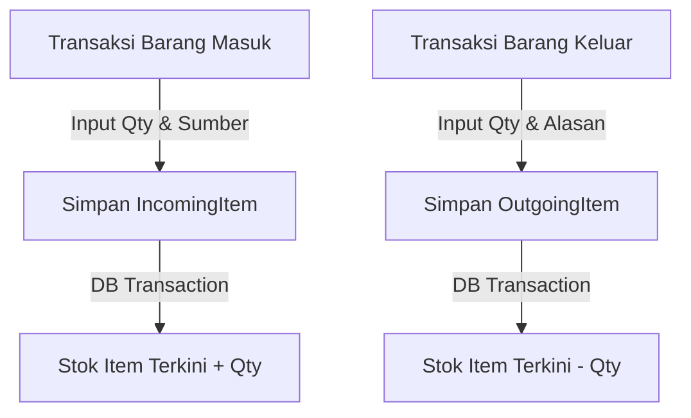

# Sistem Informasi Inventaris dan Logistik Sekolah (SIILS)

**Sistem Informasi Inventaris dan Logistik Sekolah Berbasis Web secara Terpusat**

Sistem Informasi Inventaris dan Logistik Sekolah (SIILS) adalah aplikasi manajemen aset, transaksi logistik (barang masuk, barang keluar, dan distribusi), pengajuan permohonan kebutuhan inventaris multi-item, manajemen dokumen/BAST terlampir, serta rekapitulasi laporan berwewenang multi-peran (*multi-role*). Sistem ini dirancang untuk memastikan tata kelola sarana prasarana sekolah transparan, efisien, dan memiliki rekam jejak audit (*audit trail*) yang tidak dapat diubah sembarangan. Semua data pengguna dilindungi dengan verifikasi status aktif serta autentikasi kata sandi terenkripsi.

---

## 📋 Daftar Isi
- [1. Fitur Utama](#1-fitur-utama)
- [2. Role dan Alur Akses](#2-role-dan-alur-akses)
- [3. Gambaran Alur Sistem](#3-gambaran-alur-sistem)
- [4. Panduan Penggunaan Bertahap per Role](#4-panduan-penggunaan-bertahap-per-role)
- [5. Tech Stack](#5-tech-stack)
- [6. Instalasi Lokal](#6-instalasi-lokal)
- [7. Menjalankan Test](#7-menjalankan-test)
- [8. Struktur Folder Penting](#8-struktur-folder-penting)
- [9. Continuous Integration](#9-continuous-integration)
- [10. Catatan Desain yang Disengaja](#10-catatan-desain-yang-disengaja)
- [11. Catatan Teknis](#11-catatan-teknis)
- [12. Glosarium](#12-glosarium)
- [13. Status Pengembangan dan Batasan Scope](#13-status-pengembangan-dan-batasan-scope)
- [14. Troubleshooting dan FAQ](#14-troubleshooting-dan-faq)
- [15. Panduan Pemakaian Resmi di Sekolah](#15-panduan-pemakaian-resmi-di-sekolah)
- [16. Cara Berkontribusi](#16-cara-berkontribusi)
- [17. Lisensi](#17-lisensi)

---

## 1. Fitur Utama

| Fitur | Keterangan |
|---|---|
| **Autentikasi & Guard Status Aktif** | Autentikasi berbasis session (Email atau Username) dengan pencegahan login otomatis untuk pengguna berstatus nonaktif (`is_active = 0`). |
| **Dashboard Ringkasan Multi-Role** | Halaman utama read-only yang menampilkan total aset inventaris, jumlah lokasi, dan pengajuan pending sesuai konteks wewenang. |
| **Pengajuan Barang Multi-Item** | Pembuatan permohonan kebutuhan sarana prasarana oleh Kajur yang mendukung pendaftaran banyak jenis item dalam satu pengajuan. |
| **Edit Draft Pengajuan** | Fitur khusus Kajur untuk memperbarui detail dan daftar barang pengajuan selama statusnya masih berstatus `draft`. |
| **Verifikasi & Formulasi Sarpras** | Peninjauan teknis dan pencatatan pertimbangan ketersediaan oleh pihak Sarpras sebelum diajukan ke Kepala Sekolah. |
| **Approval Kepala Sekolah** | Keputusan persetujuan (*approved*) atau penolakan (*rejected*) oleh Kepala Sekolah yang disertai catatan resmi keputusan. |
| **Master Inventaris & Agregat Stok** | Pengelolaan data barang master (1 kode = 1 jenis barang) dengan perhitungan stok otomatis real-time. |
| **Log Barang Masuk & Barang Keluar** | Transaksi pencatatan barang masuk (pembelian/bantuan) yang menambah stok dan barang keluar (rusak/pemusnahan) yang mengurangi stok. |
| **Distribusi & Penyaluran** | Alokasi fisik inventaris ke ruangan atau unit kejuruan penerima beserta Berita Acara Penyaluran. |
| **Tracking Riwayat Lokasi & Kondisi** | Pencatatan otomatis setiap perpindahan lokasi (`location_histories`) dan perubahan kondisi fisik (`condition_histories`). |
| **Siklus Hidup Unit Aset** | Barang individual dilacak per unit fisik (`asset_units`) dengan **5 kondisi** (Baik, Rusak Ringan, Rusak Berat, Tidak Layak Pakai, Hilang) dan **status unit** (Aktif, Dipinjam, Dalam Perbaikan, Tidak Aktif, Dihapuskan) beserta transisi terverifikasi dan riwayat status (*append-only*). |
| **Peminjaman & Deteksi Terlambat** | Peminjaman barang per unit/habis pakai dengan status keterlambatan yang dihitung konsisten (`Loan::scopeOverdue`) tanpa menulis apa pun pada request GET. |
| **Impor Inventaris Massal** | Unggah `.xlsx`/`.csv` dengan pratinjau dan validasi **semua-atau-tidak** untuk memasukkan data awal dari spreadsheet. |
| **Cadangan & Pemulihan** | Perintah `php artisan siils:backup`/`siils:restore` (round-trip teruji di MySQL 8.0 & MariaDB 10.11), rotasi log harian, dan peringatan backup kedaluwarsa lewat `siils:check`. |
| **Manajemen Dokumen & BAST** | Unggah, pengunduhan aman, dan penghapusan dokumen pendukung (Nota, BAST, Foto) terorganisir per kategori. |
| **Laporan Rekapitulasi & Mode Cetak** | Filter laporan berdasarkan jenis transaksi, rentang tanggal, dan jurusan yang dilengkapi halaman khusus siap cetak (*print mode*). |
| **Manajemen Pengguna & Toggle Status** | Pengelolaan data staf pengguna oleh Sarpras termasuk pengaktifan dan penonaktifan akun pengguna. |

**Jenis laporan yang tersedia:** Rekap Inventaris Barang, Log Barang Masuk, Log Barang Keluar, Log Distribusi/Penyaluran, Riwayat Pengajuan, **Laporan Peminjaman**, dan **Riwayat Kondisi Barang**. Semua laporan mendukung filter (periode, jurusan, status, dan filter spesifik tiap jenis), paginasi, mode cetak, serta ekspor PDF dan Excel.

---

## 2. Role dan Alur Akses

### Tabel Hak Akses Pengguna

| Role | Halaman Login | Halaman Awal | Ringkasan Hak Akses |
|---|---|---|---|
| **Kajur (Kepala Kejuruan)** | `/login` | `/home` | Membuat & mengedit pengajuan draft, memantau pengajuan, melihat inventaris & laporan terbatas jurusannya, mengunggah dokumen. |
| **Sarpras (Operator & Logistik)** | `/login` | `/home` | Mengelola master barang & lokasi, meninjau pengajuan Kajur, mencatat barang masuk/keluar/distribusi, manajemen dokumen, manajemen pengguna. |
| **Kepala Sekolah** | `/login` | `/home` | Meninjau pengajuan berstatus `reviewed_sarpras`, memberikan keputusan approval/reject, memantau seluruh laporan rekapitulasi sekolah. |

### Aturan Akses & Batasan Konteks Jurusan
- **Penyimpanan Role & Guard:** Peran pengguna disimpan pada kolom `role` di tabel `users` (`kajur`, `sarpras`, `kepala_sekolah`). Pemeriksaan otorisasi dilakukan melalui custom middleware `App\Http\Middleware\RoleMiddleware`.
- **Pengalihan Akses Ditolak:** Jika pengguna mencoba mengakses URL milik peran lain (misal Kajur mengakses `/sarpras/inventory`), sistem menghentikan eksekusi dengan response **403 Forbidden**.
- **Pencegahan Login Non-Aktif:** Pengguna dengan `is_active = false` tidak dapat login meskipun kata sandi benar.
- **Konteks Jurusan (Department Scoping):** Kajur hanya dapat melihat dan mengelola data yang terikat dengan nama jurusannya (`user->department`). Sarpras dan Kepala Sekolah memiliki wewenang global seluruh sekolah.
- **Rute Terbuka Umum:** Hanya rute `/login` yang dapat diakses oleh tamu (*guest*). Seluruh rute aplikasi lainnya wajib terautentikasi (`auth`).

---

## 3. Gambaran Alur Sistem

### (a) Alur Pengajuan Barang (Draft -> Process -> Approval)


*Penjelasan:* Kajur menyusun kebutuhan dalam status `draft`. Setelah di-submit, Sarpras memberikan catatan teknis, dan Kepala Sekolah memberikan keputusan akhir disetujui atau ditolak. Pengajuan yang disetujui kemudian **direalisasikan** oleh Sarpras (barang masuk + stok/unit aset dicatat dan tertaut ke pengajuan) sehingga status berhenti di **`realized` (Terealisasi)** — bukan lagi berhenti di `approved`. Penolakan wajib disertai alasan (`principal_notes`) dan dapat diajukan ulang oleh Kajur sebagai draf revisi.

### (b) Alur Pengelolaan Master Barang, Lokasi, dan Kondisi


*Penjelasan:* Data master barang terpisah dari riwayat fisik. Perpindahan ruangan dan perubahan kondisi disimpan sebagai data riwayat bertambah (*append-only*).

### (c) Alur Stok Masuk dan Keluar


*Penjelasan:* Perubahan stok barang masuk dan keluar diproses dalam satu transaksi database atomik untuk menjamin konsistensi stok.

### (d) Siklus Hidup Unit Aset (Kondisi & Status)

Barang bertipe **individual** dilacak per unit fisik pada tabel `asset_units`. Kondisi dan status unit adalah dua dimensi terpisah.

**Kondisi** (5 nilai, sumber kebenaran `App\Support\AssetCondition`): `baik`, `rusak_ringan`, `rusak_berat`, `tidak_layak_pakai`, `hilang`.

**Status unit** (`AssetUnit::STATUS_LABELS`) beserta transisi yang diizinkan — **hanya Sarpras**; Kajur dan Kepala Sekolah hanya membaca:

| Dari | Ke | Aturan |
|---|---|---|
| `aktif` | `dalam_perbaikan` | Alasan wajib |
| `dalam_perbaikan` | `aktif` | Wajib memilih kondisi hasil perbaikan (bawaan `baik`) |
| `aktif`, `dalam_perbaikan` | `tidak_aktif` | Alasan wajib |
| `tidak_aktif` | `aktif` | Alasan wajib (reaktivasi eksplisit) |
| `aktif`, `dalam_perbaikan`, `tidak_aktif` | `disposed` | Alasan wajib, konfirmasi, **final** |
| `dipinjam` | apa pun | **Ditolak** — selesaikan pengembalian lebih dulu |

- Kondisi `hilang`/`tidak_layak_pakai` otomatis menjadikan unit `tidak_aktif` (tercatat di riwayat dengan alasan "Kondisi: …"); **ditolak** bila unit sedang `dipinjam`. Mengubah kondisi kembali ke `baik` **tidak** mengaktifkan ulang unit.
- Pengembalian peminjaman menerima `baik`, `rusak_ringan`, `rusak_berat` (→ `dalam_perbaikan`) dan `tidak_layak_pakai` (→ `tidak_aktif`). `hilang` hanya lewat aksi di inventaris.
- **Stok barang individual = jumlah unit non-`disposed`.** Menghapuskan unit mengurangi `items.stock` sebanyak 1 (tidak di bawah 0) tetapi baris unit tetap ada. Daftar dan ekspor menyembunyikan unit `disposed` secara bawaan kecuali filter status `disposed` dipilih.
- Setiap perubahan status menulis riwayat *append-only* di `asset_unit_status_histories` (unit, barang, dari, ke, alasan, pengguna, waktu) dan tercatat juga pada riwayat aktivitas; ditampilkan sebagai linimasa di detail barang.

### (e) Status Terlambat Peminjaman

Status **Terlambat** dihitung *efektif* (bukan disimpan ulang) lewat `Loan::scopeOverdue()`: baris berstatus `dipinjam` **atau** `terlambat` yang `due_date`-nya lebih awal dari hari ini (zona waktu `Asia/Jakarta`), tanpa fungsi SQL khusus driver. Daftar peminjaman, laporan (filter, kartu ringkasan, hari terlambat), badge sidebar (`TaskOverview`), dan dashboard memakai scope ini. **Request GET tidak pernah menulis ke tabel `loans`** — tidak ada lagi "status terlambat baru muncul setelah daftar dibuka".

---

## 4. Panduan Penggunaan Bertahap per Role

### A. Panduan Tugas Kajur (Kepala Kejuruan)

#### Tugas 1: Membuat Pengajuan Barang Multi-Item
1. Buka browser dan navigasi ke URL `/login`.
2. Masukkan username `kajur_rpl` dan password `password123`, lalu klik **Masuk**.
3. Pilih menu **Pengajuan Barang** > **Buat Pengajuan Baru**.
4. Isi **Judul Pengajuan** dan **Maksud & Tujuan**.
5. Pada baris item barang, masukkan Nama Barang, Jumlah, Satuan, Estimasi Harga, dan Spesifikasi.
6. Klik tombol **Tambah Item Lainnya** jika ingin menambah barang kedua/ketiga.
7. Klik **Simpan Sebagai Draft** atau **Ajukan Langsung ke Sarpras**.
   

#### Tugas 2: Mengedit Draft Pengajuan
1. Masuk ke menu **Pengajuan Barang** > **Daftar Pengajuan**.
2. Klik tombol **Detail** pada pengajuan yang berstatus *Draft*.
3. Klik tombol **Edit Draft** di bagian bawah halaman.
4. Ubah jumlah, nama barang, atau spesifikasi item kebutuhan.
5. Klik **Simpan Perubahan Draft** atau **Simpan & Kirimkan ke Sarpras**.
   

#### Tugas 3: Menindaklanjuti Penolakan dan Melihat Status Realisasi
1. Pada **Daftar Pengajuan**, pengajuan yang ditolak menampilkan badge **Ditolak**.
2. Buka halaman **Detail** — alasan penolakan Kepala Sekolah tampil di **Linimasa Proses Pengajuan**.
3. Klik **Ajukan Ulang** untuk membuat **draf revisi** dari pengajuan yang ditolak (tanpa mengetik ulang dari nol), sesuaikan, lalu kirimkan lagi.
4. Pengajuan yang sudah direalisasikan menampilkan badge **Terealisasi**; masuk ke **Notifikasi** (lonceng di kanan atas) untuk melihat pemberitahuannya.

#### Tugas 4: Mengubah Kata Sandi Sendiri (Akun Saya)
1. Klik gambar profil di kanan atas → **Akun Saya**.
2. Isi kata sandi saat ini, kata sandi baru, dan konfirmasi.
3. Klik **Simpan**.

---

### B. Panduan Tugas Sarpras (Operator & Logistik)

#### Tugas 1: Memproses Pengajuan Kajur
1. Login dengan akun Sarpras (`sarpras` / `password123`).
2. Masuk ke menu **Administrasi** > **Review Pengajuan Kajur**.
3. Klik tombol **Detail & Telaah** pada daftar permohonan berstatus *Menunggu Review*.
4. Masukkan **Catatan Telaah Sarpras** pada form verifikasi.
5. Klik **Kirimkan ke Kepala Sekolah**. Status berubah menjadi `reviewed_sarpras`.
   

#### Tugas 2: Pencatatan Log Barang Masuk
1. Masuk ke menu **Logistik** > **Barang Masuk**.
2. Pilih nama barang inventaris dari dropdown.
3. Masukkan jumlah kuantitas barang, sumber asal (Pembelian/Bantuan), nama asal toko/instansi, dan tanggal masuk.
4. Klik **Simpan Transaksi Barang Masuk**. Stok master barang otomatis bertambah.
   

#### Tugas 3: Mengunggah Berkas / BAST
1. Masuk ke menu **Dokumen & Berkas**.
2. Klik **Unggah Dokumen Baru**.
3. Isi Judul Dokumen, pilih Kategori (Nota/BAST/Surat Bantuan/Foto/Umum), dan pilih file PDF/Gambar (max 10MB).
4. Klik **Simpan Dokumen**.
   

#### Tugas 4: Merealisasikan Pengajuan yang Disetujui
1. Masuk ke menu **Administrasi** > **Pengajuan Siap Direalisasi** (badge jumlah tugas pada sidebar).
2. Klik **Realisasikan** pada pengajuan berstatus *Disetujui*.
3. Untuk tiap baris pilih mode **Barang Baru** atau **Barang Sudah Ada**, kuantitas diterima, kategori, satuan, lokasi, dan kondisi.
4. Catat **Sumber Barang** (Pembelian/Bantuan) dan **Tanggal Masuk**, lalu klik **Simpan Realisasi**.
5. Barang masuk tercatat, stok/unit aset bertambah, dan status pengajuan menjadi **Terealisasi**.

#### Tugas 5: Mereset Kata Sandi Pengguna
1. Masuk ke menu **Administrasi** > **Manajemen Pengguna**.
2. Klik **Reset Sandi** pada akun Kajur/Staf yang lupa kata sandi.
3. Sistem membuat kata sandi sementara yang **wajib diganti saat login berikutnya**; sampaikan kepada pengguna yang bersangkutan.
4. Kata sandi sementara hanya ditampilkan sekali lalu langsung dibersihkan dari sesi; kata sandi tidak pernah tercatat di riwayat aktivitas maupun log aplikasi.
5. Mereset kata sandi otomatis mencabut seluruh sesi login lama akun tersebut.
6. Alternatif via konsol: `php artisan siils:reset-password <username>`.

#### Tugas 6: Impor Inventaris Massal (Excel/CSV)
1. Masuk ke menu **Inventaris** lalu klik **Impor Inventaris** (tombol di kanan atas daftar barang).
2. Unduh **Template .xlsx** resmi. Template memuat lembar *Data* (contoh baris) dan *Petunjuk* (daftar kolom serta nilai validnya).
3. Isi data: **satu baris untuk satu unit** barang individual, sedangkan barang **habis pakai** cukup satu baris dengan kolom **Stok Awal**.
4. Unggah berkas (format `.xlsx` atau `.csv`, maksimal **2 MB** dan **2.000 baris**), lalu tinjau **Pratinjau**.
5. Pratinjau menampilkan jumlah barang & unit yang akan dibuat. Bila ada kesalahan, daftar kesalahan per **baris/kolom** ditampilkan dalam Bahasa Indonesia dan dapat diunduh sebagai CSV.
6. Klik **Konfirmasi** untuk menyimpan. Impor bersifat **semua-atau-tidak**: bila ada satu saja kesalahan, tidak ada data yang ditulis.

Catatan penting:
- Kolom **Kode Barang** dan **Nomor Inventaris Unit** boleh dikosongkan; sistem membuat nomornya otomatis (mis. `BRG-RPL-0001`).
- Baris dengan **Kode Barang sama** digabung menjadi satu barang dengan beberapa unit (khusus barang individual).
- **Nomor seri** dan **nomor inventaris unit** yang sudah terdaftar, atau yang duplikat di dalam berkas, dilaporkan sebagai kesalahan.
- Rumus spreadsheet **tidak dievaluasi** (berkas dibaca sebagai data saja), sehingga sel berisi rumus diperlakukan sebagai teks kosong/tidak valid.
- Impor memakai layanan registrasi yang sama dengan form master barang, sehingga riwayat kondisi & lokasi serta stok tetap konsisten.
- Setiap impor dicatat **satu kali** di riwayat aktivitas sebagai aksi `inventory_imported` beserta ID batch dan ringkasan jumlah barang/unit.

#### Keamanan Sesi & Kata Sandi
- Setiap pengguna yang **mengganti kata sandinya sendiri** akan mendapat **ID sesi baru**; seluruh sesi login lain yang memakai akun yang sama dicabut seketika (untuk driver sesi `database`). Pada driver lain yang tidak menyimpan sesi sebagai baris, pencabutan menyeluruh tidak dapat dilakukan — disarankan memakai driver sesi `database` (default).
- `SESSION_ENCRYPT=true` di `.env.example`: payload sesi dienkripsi di penyimpanan (kolom `payload` tabel `sessions`) sehingga nilai flash seperti kata sandi sementara tidak tersimpan sebagai teks terbaca. Setelah nilai ini diaktifkan, **seluruh sesi lama menjadi tidak valid** dan pengguna harus login ulang.

---

### C. Panduan Tugas Kepala Sekolah

#### Tugas 1: Memberikan Approval Pengajuan
1. Login dengan akun Kepala Sekolah (`kepsek` / `password123`).
2. Masuk ke menu **Persetujuan Pengajuan**.
3. Klik **Review & Putuskan** pada pengajuan yang memerlukan persetujuan.
4. Periksa rincian item barang dan catatan telaah Sarpras.
5. Masukkan catatan persetujuan pada kolom **Catatan Kepala Sekolah**.
6. Klik **Setujui Pengajuan** atau **Tolak Pengajuan**.
   

#### Tugas 2: Filter dan Cetak Laporan
1. Masuk ke menu **Laporan & Monitoring**.
2. Pilih jenis rekapitulasi (Inventaris, Barang Masuk, Barang Keluar, Distribusi, Pengajuan, Peminjaman, atau Riwayat Kondisi).
3. Tentukan rentang tanggal dan jurusan (jika diperlukan), lalu klik **Filter**.
4. Klik tombol **Cetak** untuk membuka halaman versi cetak bebas komponen navigasi web.
   

#### Tugas 2: Keputusan Penolakan yang Beralasan
1. Saat menolak pengajuan (`reviewed_sarpras`), kolom **Catatan Kepala Sekolah** **wajib diisi** minimal 10 karakter sebagai alasan penolakan.
2. Alasan tersebut langsung tampil di halaman **Detail Pengajuan** Kajur dan menjadi dasar pengajuan ulang.

---

### D. Notifikasi & Akun Saya (Lintas Peran)

- **Notifikasi dalam aplikasi** (ikon lonceng di kanan atas): pemberitahuan saat pengajuan **diajukan, ditinjau, disetujui, ditolak, atau direalisasikan**. Halaman **Notifikasi** menampilkan riwayat lengkap beserta tombol **Tandai Semua Dibaca**.
- **Panel "Tugas Anda"** di beranda merangkum tugas per peran (pengajuan draft, pengajuan menunggu review/realisasi, dan keputusan yang menunggu persetujuan).
- Sesuai batasan `AGENTS.md`, notifikasi **hanya dalam aplikasi** (kanal database) — **tidak ada pengiriman WhatsApp/e-mail** atau integrasi pihak ketiga.
- **Akun Saya** (menu gambar profil, tersedia untuk semua peran) untuk mengganti kata sandi sendiri.
- Toggle **tampil/sembunyikan** kata sandi tersedia pada form login.

---

## 5. Tech Stack

- **Backend Framework:** Laravel v13.x / PHP v8.3+ (diuji pada PHP 8.3 & 8.4 di CI)
- **Frontend Template & UI:** Blade Engine, Metronic Design System, Tailwind CSS, Bootstrap Icons
- **Asset JS:** File statis `public/js/siils.js` (tanpa Node/Vite)
- **Database (Development/Local):** MySQL v8.0 / MariaDB 10.4+ (default), SQLite sebagai alternatif
- **Database (Testing):** SQLite In-Memory
- **Framework Pengujian:** PHPUnit v12.x / Laravel Testing Toolkit

---

## 6. Instalasi Lokal

Panduan ini diuji pada Windows (Laragon) dan Linux/macOS. **Node.js tidak diperlukan** untuk instalasi; aset JS dimuat sebagai file statis.

### A. Persyaratan

| Komponen | Versi / Keterangan |
|---|---|
| **PHP** | 8.3 atau 8.4 (diuji otomatis di CI pada 8.3 & 8.4; juga berjalan di 8.5) |
| **Ekstensi PHP** | `ctype`, `curl`, `dom`, `fileinfo`, `filter`, `gd`, `iconv`, `mbstring`, `openssl`, `simplexml`, `xmlreader`, `xmlwriter`, `zip`, `zlib`, dan `pdo_mysql` (atau `pdo_sqlite` bila memakai SQLite) |
| **Composer** | 2.x |
| **Database** | MySQL 8.0+ atau MariaDB 10.4+ (diuji otomatis di CI: `mysql:8.0` dan `mariadb:10.11`) |
| **Node.js / npm** | Tidak diperlukan — aset JS dimuat sebagai file statis `public/js/siils.js` |
| **Web server** | Laragon/XAMPP (Windows) atau bawaan `php artisan serve` |

### B. Mulai Cepat di Laragon (Windows)

1. Pasang **Laragon Full** (sudah membawa Apache/Nginx, MySQL/MariaDB, PHP, dan Composer).
2. Buka Laragon, klik **Start All** sampai indikator Apache/Nginx dan MySQL berwarna hijau.
3. Pilih versi PHP yang sesuai: menu **PHP → Versi → 8.3 atau 8.4**, lalu tunggu Laragon menyesuaikan.
4. Aktifkan ekstensi yang dibutuhkan: menu **PHP → Ekstensi**, lalu pastikan `gd`, `zip`, `pdo_mysql`, `mbstring`, `curl`, `fileinfo`, `openssl`, `iconv`, `simplexml`, `xmlreader`, `xmlwriter`, `ctype`, dan `dom` tercentang (Laragon umumnya sudah mengaktifkannya).
5. Letakkan proyek ini di `C:\laragon\www\siils`. Jika fitur *Auto virtual hosts* aktif, Laragon membuat alamat `http://siils.test` (set `APP_URL=http://siils.test` pada `.env`).
6. Buka **Terminal Laragon** (klik kanan ikon Laragon → **Terminal**) di dalam folder proyek.
7. Jalankan satu perintah yang menangani `.env`, kunci aplikasi, pembuatan database, migrasi, dan data demo:
   ```bash
   composer setup
   ```
8. Buka `http://siils.test` (atau `http://localhost/siils`) di peramban, lalu login memakai [akun demo](#akun-demo-default-dari-seeder).

`composer setup` menjalankan `composer install` lalu `php artisan siils:install`. Perintah `siils:install` bersifat **idempoten** (aman dijalankan berulang) dan melakukan:

- Menyalin `.env.example` menjadi `.env` bila belum ada, lalu membuat `APP_KEY`.
- Membuat database `siils` bila belum ada (`CREATE DATABASE IF NOT EXISTS ... utf8mb4_unicode_ci`).
- Menjalankan `migrate --force` dan `db:seed`.

Sebelum/sesudah instalasi, Anda dapat memeriksa prasyarat kapan saja:

```bash
php artisan siils:check
```

### C. Instalasi Manual (Lintas OS)

Perintah berikut berlaku di **cmd/PowerShell** (Windows) maupun **bash** (Linux/macOS).

```bash
# 1. Clone repository
git clone https://github.com/Moefkiim/Sistem-Informasi-Inventaris-dan-Logistik-Sekolah-Berbasis-Web.git
cd Sistem-Informasi-Inventaris-dan-Logistik-Sekolah-Berbasis-Web

# 2. Pasang dependensi PHP dan siapkan aplikasi (env, key, database, migrasi, data demo)
composer install
php artisan siils:install
```

Bila ingin menyalin `.env` secara manual sebelum instalasi:

- **cmd:** `copy .env.example .env`
- **PowerShell:** `Copy-Item .env.example .env`
- **bash:** `cp .env.example .env`

Sesuaikan kredensial database pada `.env`, lalu jalankan `php artisan siils:install`.

Menjalankan server pengembang:

```bash
php artisan serve
```

Aplikasi dapat dibuka di `http://127.0.0.1:8000`.

### D. Memakai SQLite (opsional)

SQLite hanya sebagai alternatif cepat tanpa server database. Set pada `.env`:

```dotenv
DB_CONNECTION=sqlite
DB_DATABASE=/path/absolut/ke/database.sqlite
```

`siils:install` akan membuat berkas SQLite tersebut bila belum ada. Data demo dibuat ulang oleh seeder; isi berkas `database.sqlite` lama tidak dipindahkan otomatis ke MySQL.

### Penjelasan Variabel Konfigurasi `.env`

| Variabel `.env` | Fungsi Konfigurasi | Contoh Nilai Aman |
|---|---|---|
| `APP_NAME` | Nama aplikasi yang tampil pada judul halaman | `SIILS Sekolah` |
| `APP_ENV` | Mode lingkungan aplikasi (local/production) | `local` |
| `APP_KEY` | Kunci enkripsi session & password | `base64:...` *(dibuat otomatis)* |
| `APP_URL` | URL domain utama server | `http://localhost:8000` atau `http://siils.test` |
| `APP_TIMEZONE` | Zona waktu tampilan jam dan tanggal | `Asia/Jakarta` |
| `APP_LOCALE` | Bahasa antarmuka & pesan validasi | `id` |
| `SESSION_ENCRYPT` | Enkripsi payload sesi di penyimpanan (aktif = sesi lama tidak valid) | `true` |
| `SESSION_DRIVER` | Driver sesi; disarankan `database` agar sesi bisa dicabut per akun | `database` |
| `DB_CONNECTION` | Driver database (`mysql` / `mariadb` / `sqlite`) | `mysql` |
| `DB_HOST` | Host server database | `127.0.0.1` |
| `DB_PORT` | Port server database | `3306` |
| `DB_DATABASE` | Nama DB MySQL (path berkas bila SQLite) | `siils` |
| `DB_USERNAME` | User database (default Laragon) | `root` |
| `DB_PASSWORD` | Kata sandi database (default Laragon kosong) | *(kosong)* |

> **Zona waktu.** `APP_TIMEZONE` hanya memengaruhi cara aplikasi **menafsirkan** jam saat menyimpan/menampilkan data. Instalasi baru berisi data demo, sehingga tidak ada konversi data historis yang diperlukan. Bila Anda mengubah `APP_TIMEZONE` setelah menyimpan data nyata, waktu pada data lama tidak digeser otomatis.

---

### Akun Demo Default dari Seeder

> ⚠️ **Peringatan:** Akun demo di bawah ini dihasilkan oleh seeder (`DatabaseSeeder` → `BaseUserSeeder` + seeder demo) dan hanya ditujukan untuk lingkungan pengujian lokal. Jangan gunakan kata sandi ini pada server produksi live!

| Peran (Role) | Username | Password | Keterangan / Jurusan |
|---|---|---|---|
| **Kajur RPL** | `kajur_rpl` | `password123` | Kepala Kejuruan RPL |
| **Kajur TKJ** | `kajur_tkj` | `password123` | Kepala Kejuruan TKJ (dibuat oleh seeder demo) |
| **Sarpras** | `sarpras` | `password123` | Staf Sarana Prasarana Sekolah |
| **Kepala Sekolah** | `kepsek` | `password123` | Kepala Sekolah |
| **User Nonaktif** | `user_nonaktif` | `password123` | Pengujian blokir login |

> Menjalankan `php artisan siils:install --tanpa-demo` hanya membuat akun dasar (`kajur_rpl`, `sarpras`, `kepsek`, `user_nonaktif`) tanpa akun `kajur_tkj` dan tanpa data demo.

### Membuat Akun Pengguna Baru
Pendaftaran akun secara mandiri (*self-registration*) ditiadakan untuk menjaga keamanan. Seluruh akun pengguna baru (Kajur/Staf) dibuat secara eksklusif oleh pihak **Sarpras** melalui menu **Manajemen Pengguna** (`/sarpras/users`).

### Daftar Jurusan Resmi

Sumber tunggal daftar jurusan berada di `config/departments.php` (helper `app/Support/Departments.php`). Kode jurusan dipakai untuk scoping data Kajur dan validasi input:

| Kode | Nama Jurusan |
|---|---|
| `RPL` | Rekayasa Perangkat Lunak |
| `TKJ` | Teknik Komputer dan Jaringan |
| `TKRO` | Teknik Kendaraan Ringan Otomotif |
| `TBSM` | Teknik Bisnis Sepeda Motor |
| `AKL` | Akuntansi dan Keuangan Lembaga |
| `OTKP` | Otomatisasi dan Tata Kelola Perkantoran |

> Untuk menambah jurusan, cukup ubah `config/departments.php`; seluruh dropdown, validasi, dan scoping laporan otomatis mengikuti.

### Melihat Isi Database (HeidiSQL / phpMyAdmin)

1. Buka **HeidiSQL** dari menu **Database** di Laragon, atau **phpMyAdmin** di `http://localhost/phpmyadmin`.
2. Pilih database `siils`.
3. Tabel yang diharapkan: `users`, `locations`, `items`, `asset_units`, `incoming_items`, `outgoing_items`, `distributions`, `submissions`, `submission_items`, `submission_histories`, `loans`, `activity_logs`, `condition_histories`, `location_histories`, `documents`, `notifications`, `migrations`.
4. Contoh query:
   ```sql
   SELECT role, COUNT(*) AS jumlah FROM users GROUP BY role;
   ```
5. Perkiraan jumlah baris setelah `php artisan siils:install` (data demo lengkap):

   | Tabel | Perkiraan Baris |
   |---|---:|
   | `users` | 5 |
   | `locations` | 6 |
   | `items` | 9 |
   | `asset_units` | 13 |
   | `incoming_items` | 9 |
   | `outgoing_items` | 4 |
   | `distributions` | 2 |
   | `submissions` | 8 |
   | `submission_items` | 10 |
   | `submission_histories` | 22 |
   | `loans` | 5 |
   | `activity_logs` | 41 |
   | `condition_histories` | 15 |
   | `location_histories` | 13 |
   | `notifications` | 1 |
   | `documents` | 0 |

   > Jumlah di atas berasal dari seeder demo pada mode lokal (termasuk skenario pengajuan yang
   > **terealisasi** dan **draf revisi**, yang dijalankan lewat jalur aplikasi
   > `SubmissionRealizationService` sehingga memicu 1 notifikasi "Pengajuan Terealisasi" kepada
   > pengaju). Modul Dokumen memang dibiarkan kosong (tidak ada berkas palsu). Seeder bersifat
   > idempoten: menjalankan `php artisan db:seed` dua kali tidak menggandakan baris.

---

## 7. Menjalankan Test

Proyek ini dilengkapi suite pengujian otomatis berbasis PHPUnit (**376 test, 1601 asersi**) untuk menguji alur autentikasi, siklus hidup unit aset, keterlambatan peminjaman, backup/restore, impor inventaris, penjaga N+1, serta alur pengajuan, logistik, dan pelaporan. Suite dijalankan pada **SQLite 8.3/8.4**, **MySQL 8.0 8.3/8.4**, dan **MariaDB 10.11** (CI), ditambah job `browser-smoke` (Playwright/axe-core) serta uji round-trip backup pada MySQL/MariaDB.

### Perintah Pengujian

```bash
# Jalankan seluruh unit & feature test (SQLite in-memory, cepat)
php artisan test

# Jalankan file test tertentu
php artisan test --filter=AuthenticationAndRoleAccessTest

# Menjalankan seluruh suite terhadap MySQL lokal
# (set DB_CONNECTION=mysql dan DB_DATABASE pada lingkungan sebelum perintah)
php artisan test
```

### Cakupan Test (contoh file penting)

| File Test | Cakupan & Fitur yang Diuji |
|---|---|
| `tests/Feature/AuthenticationAndRoleAccessTest.php` | Render login, autentikasi via Email & Username, penolakan kata sandi salah, pencegahan login user nonaktif, logout, serta isolasi rute antar role (403). |
| `tests/Feature/WorkflowTransitionTest.php` | Rantai transisi pengajuan `draft → submitted → reviewed_sarpras → approved/rejected` dan larangan lompat status. |
| `tests/Feature/DemoDataSeederTest.php` | Invarian seeder demo: jumlah unit = stok barang individual, tidak ada stok negatif, nomor unik, tiap status terwakili, idempoten. |
| `tests/Feature/DemoReadinessTest.php` | Uji asap per role: login tiap akun demo dan membuka halaman utama (dashboard, inventaris, laporan, pengajuan/persetujuan, peminjaman, aktivitas). |
| `tests/Feature/ReportScopingTest.php` | Filter laporan per jenis, scoping jurusan Kajur, dan akses role lain. |
| `tests/Feature/InstallCommandTest.php` | Perintah `siils:check`/`siils:install`: keluar 0/non-nol, idempotensi, penolakan `--fresh` di produksi, validasi nama database. |
| `tests/Feature/SubmissionRealizationTest.php` | Realisasi pengajuan: barang baru individual/consumable, barang inventaris yang sudah ada, kuantitas melebihi permintaan ditolak, realisasi ganda ditolak, riwayat lokasi/kondisi bagi unit baru. |
| `tests/Feature/SubmissionNotificationTest.php` | Notifikasi dalam aplikasi untuk tiap peristiwa (diajukan, ditinjau, disetujui, ditolak, direalisasi) dan URL tujuan per peran. |
| `tests/Feature/EndToEndWorkflowTest.php` | Alur menyeluruh lintas role (Kajur → Sarpras → Kepala Sekolah → realisasi; jalur penolakan + ajukan ulang), berjalan di SQLite & MySQL. |
| `tests/Feature/InventoryImportTest.php` | Impor inventaris `.xlsx`/`.csv`: pembuatan barang & unit, kode otomatis, kesalahan bernomor baris, sifat semua-atau-tidak, duplikat kode/seri, batas ukuran/tipe/jumlah baris, rumus tidak dievaluasi, dan pembatasan akses hanya Sarpras. |
| `tests/Feature/AssetUnitStatusLifecycleTest.php` | Siklus hidup unit aset: matriks transisi status (diizinkan/ditolak), unit `dipinjam` & `disposed` terkunci, `disposed` mengurangi stok, kondisi `hilang`/`tidak_layak_pakai` → `tidak_aktif`, riwayat status *append-only*, dan 403 untuk role selain Sarpras. |
| `tests/Feature/AssetUnitConditionTest.php` | Perubahan kondisi unit per unit beserta riwayatnya (termasuk 5 nilai kondisi), unit lain tidak terpengaruh, dan fallback barang legacy tanpa unit. |
| `tests/Feature/LoanOverdueStatusTest.php` | Terlambat efektif via `scopeOverdue`, batas hari jatuh tempo (`Asia/Jakarta`), daftar/laporan/ringkasan konsisten, dan bukti GET daftar peminjaman **tidak** menulis ke tabel `loans`. |
| `tests/Feature/BackupRestoreCommandTest.php` | `siils:backup`/`siils:restore`: arsip + `manifest.json`, retensi, kredensial tidak bocor ke argumen proses, berkas sementara dibersihkan, round-trip di SQLite, dan penolakan restore di production tanpa `--force`. |
| `tests/Feature/QueryBudgetTest.php` | Penjaga N+1: jumlah query identik pada 5 vs 25 baris untuk dashboard tiap role, daftar inventaris, detail barang, daftar peminjaman, riwayat aktivitas, notifikasi, dan seluruh jenis laporan (memakai `DB::listen`). |
| `tests/Feature/LocalizationTest.php` | Pesan validasi, nama bulan grafik, dan teks paginasi berbahasa Indonesia. |

> Untuk daftar lengkap, lihat folder `tests/Feature/` dan `tests/Unit/`.

---

## 8. Struktur Folder Penting

```text
.
├── app/
│   ├── Http/
│   │   ├── Controllers/
│   │   │   ├── Auth/AuthController.php      # Form & proses login/logout
│   │   │   ├── Kajur/                       # Form pengajuan & inventaris jurusan
│   │   │   ├── Principal/ApprovalController # Form approval Kepala Sekolah
│   │   │   ├── Sarpras/                     # Inventory, Logistics, Location, User CRUD
│   │   │   ├── DocumentController.php       # Manajemen upload/download berkas
│   │   │   └── ReportController.php         # Rekapitulasi laporan & print export
│   │   └── Middleware/
│   │       └── RoleMiddleware.php           # Guard hak akses berbasis role
│   └── Models/                              # Model Eloquent aplikasi
├── database/
│   ├── migrations/                          # Skema tabel database (10 tabel utama)
│   └── seeders/DatabaseSeeder.php           # Data seeder akun demo
├── resources/
│   └── views/                               # Template UI Blade Metronic & Tailwind
├── routes/
│   └── web.php                              # Pemetaan rute terproteksi middleware
├── AGENTS.md                                # Aturan bisnis & instruksi pengembang AI
├── rancangan-web.md                         # Spesifikasi arsitektur & rancangan awal
└── README.md                                # Dokumentasi utama panduan proyek
```

---

### Tabel Model Utama Database

| Model Eloquent | Tabel Database | Keterangan & Relasi Utama |
|---|---|---|
| `User` | `users` | Mengelola data kredensial, role (`kajur`, `sarpras`, `kepala_sekolah`), jurusan, dan status aktif (`is_active`). |
| `Item` | `items` | Master aset inventaris. Memiliki kolom `code`, `stock`, `current_condition`, `department`, `location_id`. *SoftDeletes*. |
| `Submission` | `submissions` | Permohonan barang. Memiliki `status` (`draft`, `submitted`, `reviewed_sarpras`, `approved`, `rejected`, `cancelled`). |
| `SubmissionItem` | `submission_items` | Rincian item barang dalam satu pengajuan (relasi `belongsTo(Submission)`). |
| `IncomingItem` | `incoming_items` | Log transaksi barang masuk yang menambah stok master item. |
| `OutgoingItem` | `outgoing_items` | Log transaksi barang keluar (rusak/pemusnahan) yang mengurangi stok master. |
| `Distribution` | `distributions` | Penyaluran inventaris ke lokasi/jurusan penerima. |
| `Location` | `locations` | Master lokasi gedung/ruangan/laboratorium. *SoftDeletes*. |
| `LocationHistory` | `location_histories` | Riwayat transaksi mutasi lokasi perpindahan fisik barang. |
| `ConditionHistory` | `condition_histories` | Riwayat pencatatan perubahan kondisi fisik barang. |
| `AssetUnit` | `asset_units` | Unit fisik barang individual: `unit_inventory_number`, `serial_number`, `current_condition` (5 nilai), `current_status` (5 nilai), `location_id`. *SoftDeletes*. |
| `AssetUnitStatusHistory` | `asset_unit_status_histories` | Riwayat *append-only* perubahan status unit (unit, barang, dari, ke, alasan, pengguna, waktu). |
| `Document` | `documents` | Data meta dan path berkas fisik (Nota, BAST, Foto). *SoftDeletes*. |

---

## 9. Continuous Integration

**Tersedia.** Repositori ini dilengkapi workflow GitHub Actions (`.github/workflows/tests.yml`) yang berjalan pada setiap `push` dan `pull_request` ke branch `main`:

- **Job `SQLite`** — matriks **PHP 8.3 & 8.4**. Menjalankan `composer install`, `composer check-platform-reqs`, migrasi SQLite, lalu seluruh suite (`php artisan test`). **Penjaga N+1 aktif**: saat test, `Model::preventLazyLoading()` melempar exception bila ada relasi diakses tanpa eager loading (`app/Providers/AppServiceProvider.php`), sehingga regresi N+1 langsung menggagalkan suite.
- **Job `MySQL/MariaDB`** — matriks **`mysql:8.0` (PHP 8.4), `mariadb:10.11` (PHP 8.4), dan `mysql:8.0` (PHP 8.3)** memakai `services` dengan healthcheck. Menjalankan `composer install`, `composer check-platform-reqs`, lalu `php artisan siils:install --force` yang **membuat database secara otomatis**, memigrasi, dan mengisi data demo pada database sungguhan; dilanjutkan `php artisan siils:check`, pemanggilan `siils:install` kedua (membuktikan idempotensi), seluruh suite, dan **uji round-trip backup** (`ci/backup-roundtrip.sh`): isi data → `siils:backup` → hapus & buat ulang database → `siils:restore` → jumlah baris semua tabel (19 tabel) dan checksum tabel kunci (`users`, `items`, `asset_units`, `submissions`, `loans`, `activity_logs`) harus sama — diuji untuk **kedua jalur** (dump `mysqldump` otomatis dan dump PHP murni `--tanpa-mysqldump`).
- **Job `Composer setup`** — **clone bersih tanpa `.env`** terhadap `mysql:8.0` (PHP 8.4). Menjalankan `composer setup` **persis seperti README** (membuat `.env` dari `.env.example`, `APP_KEY`, database, migrasi, dan seeder), lalu `php artisan siils:check`, dan **uji asap per role** (`DemoReadinessTest`: login Kajur, Sarpras, Kepala Sekolah, dan akun nonaktif).
- **Job `Browser smoke`** — **verifikasi browser nyata** dengan Playwright/Python (bukan feature aplikasi, hanya untuk CI): menjalankan `php artisan serve`, `pip install playwright` + Chromium, lalu `python3 tests/Browser/smoke.py`. Skrip menelusuri halaman ketiga role (Kajur, Sarpras, Kepala Sekolah) plus **semua jenis laporan beserta ekspor PDF/Excel/Cetak** pada viewport 1366×768, 768×1024, dan 375×812, memeriksa status 200, bebas `console.error`/`pageerror`, tanpa overflow horizontal (`scrollWidth <= clientWidth`), tanpa teks error ("SQLSTATE"/"Whoops"/"Exception"), serta menjalankan skenario interaktif (alur pengajuan → review → persetujuan → realisasi, aksi status unit, peminjaman terlambat, alur impor, toggling mode existing/new, inisialisasi **Select2**, lonceng notifikasi, halaman 404/403 khusus, dan throttle setelah 6× login salah). **Aksesibilitas:** `axe-core` dijalankan pada tiap halaman × viewport; temuan dikelompokkan per aturan ke `a11y-report.json` per halaman, dan dengan `A11Y_ENFORCE=true` job **gagal** bila ada temuan `serious`/`critical` (pengecualian hanya lewat `tests/Browser/a11y-allowlist.json` dengan alasan tertulis) — `moderate` hanya peringatan. Seluruh screenshot + trace + `INDEX.md` diunggah sebagai artifact CI **`browser-smoke-artifacts`** (retensi 14 hari).

Workflow memastikan regresi terdeteksi — termasuk perbedaan perilaku MySQL vs SQLite — sebelum perubahan digabung ke `main`.

---

## 10. Catatan Desain yang Disengaja

> 📌 **Pembuka Wajib:** Perilaku di bagian ini sengaja dibuat demikian sesuai aturan bisnis sekolah dan dapat terlihat seperti bug bagi pengguna awam. Jangan mengubah perilaku ini tanpa membaca dokumentasi aturan bisnis di `AGENTS.md` dan `rancangan-web.md`.

1. **Perilaku:** Pengajuan barang tidak dapat diubah atau dihapus oleh Kajur setelah dikirim (`submitted`).
   - *Alasan Sengaja:* Mencegah manipulasi data barang saat Sarpras atau Kepala Sekolah sedang melakukan peninjauan.
   - *Test Pengunci:* `AuthenticationAndRoleAccessTest::test_kajur_can_access_kajur_area_but_forbidden_from_other_roles`.

2. **Perilaku:** Transaksi Barang Masuk dan Keluar tidak menyediakan tombol *Delete* bebas pada UI.
   - *Alasan Sengaja:* Menjaga keutuhan rekam jejak audit log (*audit trail*). Pembatalan atau koreksi transaksi logistik dilakukan melalui transaksi penyesuaian berpemilik wewenang Sarpras.

3. **Perilaku:** Penghapusan Master Barang dan Lokasi menggunakan mekanisme *Soft-Delete*.
   - *Alasan Sengaja:* Menghindari kerusakan integritas relasi (*broken foreign keys*) pada tabel riwayat transaksi logistik masa lalu.

4. **Perilaku:** Pengguna yang dinonaktifkan (`is_active = false`) langsung ditolak saat login meskipun password benar.
   - *Alasan Sengaja:* Memastikan mutasi atau pencabutan wewenang staf yang sudah tidak bertugas berlaku seketika pada sesi login.
   - *Test Pengunci:* `AuthenticationAndRoleAccessTest::test_inactive_user_cannot_login`.

5. **Perilaku:** Perubahan lokasi dan kondisi barang selalu menambah baris baru pada tabel riwayat.
   - *Alasan Sengaja:* Prinsip *append-only tracker* diterapkan agar seluruh kronologi usia pemakaian aset sekolah dapat dilacak dari awal barang diterima.

---

## 11. Catatan Teknis

- **Privasi & Keamanan Data:** Sandi pengguna dienkripsi menggunakan algoritma `Bcrypt` dengan faktor biaya 12. Seluruh form input wajib dilengkapi proteksi `CSRF` token.
- **Driver Database:** Konfigurasi default menggunakan **MySQL/MariaDB** (driver `mysql`). SQLite tetap didukung sebagai alternatif cepat tanpa server database (`DB_CONNECTION=sqlite`). Pengujian otomatis berjalan pada SQLite in-memory (lokal) dan MySQL/MariaDB sungguhan (CI).
- **Manajemen Storage File:** Berkas dokumen terlampir disimpan pada disk privat (`storage/app/private/documents`) dan diakses melalui rute terautentikasi `DocumentController@download`. Karena berkas tidak disajikan langsung dari `public/`, perintah `php artisan storage:link` **tidak diperlukan**.
- **Zona Waktu & Lokalisasi:** `APP_TIMEZONE=Asia/Jakarta` dan `APP_LOCALE=id` secara default. Nama bulan pada grafik/laporan mengikuti locale Carbon, sehingga otomatis berbahasa Indonesia.

---

## 12. Glosarium

| Istilah | Arti & Penjelasan Domain |
|---|---|
| **Kajur** | Kepala Kejuruan, unit struktural pengaju permohonan kebutuhan inventaris jurusan. |
| **Sarpras** | Staf pengelola Sarana dan Prasarana sekolah yang mengontrol fisik aset dan logistik. |
| **BAST** | Berita Acara Serah Terima, berkas legalitas penyerahan fisik barang/bantuan. |
| **Draft** | Status awal pengajuan barang yang masih dapat disunting secara bebas oleh pengaju. |
| **Soft-Delete** | Metode penghapusan logika di mana record ditandai `deleted_at` tanpa menghapus baris database. |
| **Audit Trail** | Catatan kronologis peristiwa sistem yang merekam siapa, kapan, dan transaksi apa yang dilakukan. |

---

## 13. Status Pengembangan dan Batasan Scope

### Tabel Status Fitur Aplikasi

| Fitur Aplikasi | Status Pengoperasian | Catatan Implementasi |
|---|:---:|---|
| **Autentikasi & Guard Active Status** | ✅ Sudah | Teruji via PHPUnit test suite |
| **Dashboard Statistics** | ✅ Sudah | Read-only aggregate counts |
| **Pengajuan Multi-Item Kajur** | ✅ Sudah | Mendukung input dinamis banyak item |
| **Edit Draft Pengajuan Kajur** | ✅ Sudah | Terbatas pada status `draft` |
| **Review & Telaah Sarpras** | ✅ Sudah | Catatan ketersediaan & verifikasi |
| **Approval Kepala Sekolah** | ✅ Sudah | Keputusan setuju / tolak + catatan |
| **Log Barang Masuk & Keluar** | ✅ Sudah | Auto update stok master barang |
| **Distribusi Barang** | ✅ Sudah | Alokasi ke ruangan / jurusan |
| **Riwayat Lokasi & Kondisi** | ✅ Sudah | Append-only history logging |
| **Manajemen Dokumen & BAST** | ✅ Sudah | Upload, download, & delete Sarpras |
| **Cetak Laporan / Print Export** | ✅ Sudah | Tampilan bebas elemen navigasi web |
| **Manajemen User Sarpras** | ✅ Sudah | CRUD staf & toggle `is_active` |

### Status Teknis

| Aspek Teknis | Status | Keterangan |
|---|:---:|---|
| **CI/CD** | ✅ Terpasang | Workflow GitHub Actions (`tests.yml`) menjalankan `php artisan test` otomatis pada push/PR ke `main` (SQLite 8.3/8.4, MySQL 8.0, MariaDB 10.11), job `browser-smoke` (Playwright + axe-core), job setup dari clone bersih, dan uji round-trip backup. |
| **Penjaga N+1** | ✅ Aktif di test | `Model::preventLazyLoading()` melempar exception saat test, mencatat peringatan di `local`, dan nonaktif di production. `QueryBudgetTest` memastikan jumlah query konstan (5 vs 25 baris) pada halaman utama. |
| **Aksesibilitas (CI)** | ✅ Ditegakkan | axe-core per halaman × viewport; temuan `serious`/`critical` menggagalkan job `browser-smoke` (allowlist hanya dengan alasan tertulis). Temuan awal 83 `serious` → 0. |
| **Konsistensi CSS** | ✅ Terkonsolidasi | UI konsisten dengan gaya Metronic/Bootstrap 5; halaman `documents/index.blade.php` telah diseragamkan dan bebas dari Tailwind utility di area view terpakai. |
| **Indeks Database** | ✅ Tersedia | Migration `2026_10_02_070437_add_indexes_to_core_tables` menambah indeks pada tabel inti (termasuk `items`, `submissions`, `submission_items`, dan `documents`) untuk optimasi query. |
| **Catatan Desain yang Disengaja** | ✅ Tercatat | Field sensitif (`status`, `role`, `is_active`, dll.) sengaja dikeluarkan dari `$fillable` — controller (dan test yang memerlukan transisi state) WAJIB mengubahnya melalui set properti eksplisit (`$model->field = $value; $model->save()`) sesuai alur transisi yang benar, bukan via mass-assignment. |

### Batasan Scope (Strict Scope Boundaries)
Sistem ini secara eksplisit **TIDAK MEMILIKI** dan **DILARANG MENAMBAHKAN** fitur di bawah ini tanpa persetujuan resmi:
- Barcode / QR Code Scanner
- Notifikasi Otomatis via WhatsApp / Email
- Aplikasi Mobile (Android / iOS)
- Payment / Financial Accounting
- Supplier Management Sistem
- Integrasi Pihak Ketiga lainnya

---

## 14. Troubleshooting dan FAQ

### Reset dari Awal (hanya lokal)

Menghapus seluruh data lalu memasang ulang dari nol:

```bash
php artisan siils:install --fresh
```

`--fresh` bersifat destruktif (menghapus semua tabel) dan **ditolak** bila `APP_ENV=production`. Di produksi, gunakan `php artisan migrate --force` biasa.

### Tabel Pemecahan Masalah

| Pesan Error | Penyebab | Solusi |
|---|---|---|
| `Your lock file does not contain a compatible set of packages` | Versi PHP tidak cocok dengan `composer.lock` | Gunakan PHP 8.3/8.4 sesuai [persyaratan](#a-persyaratan), lalu `composer install`. Jangan memakai `--ignore-platform-reqs`. |
| `could not find driver` | Ekstensi PDO driver database belum aktif | Aktifkan `pdo_mysql` (atau `pdo_sqlite`) di `php.ini` (Laragon: **PHP → Ekstensi**), lalu restart. |
| `SQLSTATE[HY000] [1049] Unknown database 'siils'` | Database belum dibuat | Jalankan `php artisan siils:install` (membuat otomatis) atau buat manual di HeidiSQL/phpMyAdmin. |
| `SQLSTATE[HY000] [1045] Access denied for user` | User/password database salah | Periksa `DB_USERNAME`/`DB_PASSWORD` di `.env` (default Laragon: `root` tanpa password). |
| `SQLSTATE[HY000] [2002] Connection refused` | MySQL/MariaDB belum menyala atau host/port salah | Klik **Start All** di Laragon; pastikan `DB_HOST=127.0.0.1` dan `DB_PORT=3306`. |
| `requires ext-gd` (atau ekstensi lain) | Ekstensi PHP belum aktif | Aktifkan ekstensi terkait (mis. `gd`, `zip`) di `php.ini` (Laragon: **PHP → Ekstensi**), lalu restart. |
| `419 Page Expired` | `APP_URL`/domain berubah sehingga cookie/session tidak valid | Samakan `APP_URL` dengan alamat yang dibuka, jalankan `php artisan config:clear`, lalu login ulang. |
| `'php' is not recognized` | PHP tidak ada di PATH (cmd biasa) | Gunakan **Terminal Laragon**, atau tambahkan folder PHP ke PATH Windows. |
| Gagal menulis `storage/` atau `bootstrap/cache` | Izin folder | Beri izin tulis (Windows: properti folder → keamanan; Linux: `chmod -R 775 storage bootstrap/cache`). |
| `SQLSTATE[HY000]: General error: 1 no such table` | Database belum dimigrasi | Jalankan `php artisan siils:install` atau `php artisan migrate --force`. |

### FAQ

#### Mengapa berkas dokumen tidak bisa diunduh walau sudah diunggah?
Modul Dokumen menyimpan berkas pada disk privat dan menyajikannya lewat rute terautentikasi. Pastikan Anda sudah login; perintah `php artisan storage:link` **tidak diperlukan**.

#### Mengapa Kajur tidak melihat tombol edit pada halaman detail pengajuan?
Sesuai aturan desain, tombol edit hanya muncul bila status pengajuan masih `draft`.

---

## 15. Panduan Pemakaian Resmi di Sekolah

Bagian ini adalah ringkasan langkah operasional untuk menaikkan aplikasi dari mode uji coba (lokal) menjadi dipakai sehari-hari di sekolah. Semua langkah yang khusus Laragon ditandai **[belum diverifikasi di Laragon]**.

### A. Mode Production

1. Sunting `.env`:
   ```dotenv
   APP_ENV=production
   APP_DEBUG=false
   APP_URL=http://<alamat-ip-atau-domain>/siils
   LOG_STACK=daily
   LOG_LEVEL=warning
   ```
2. Bersihkan dan bangun ulang cache:
   ```bash
   php artisan optimize:clear
   php artisan optimize
   ```
3. Pastikan `php artisan siils:check` tidak melaporkan galat (kode keluar `0`).
4. Jangan membuka file `.env` untuk umum dan pastikan tidak ikut tercadangkan (perintah backup sudah mengecualikannya).

### B. Akses dari Komputer Lain di Jaringan Sekolah

1. Cari alamat IP server (contoh `192.168.1.10`) dan arahkan web server ke folder `public` aplikasi.
2. Set `APP_URL` sesuai alamat tersebut, misalnya `http://192.168.1.10/siils`.
3. Izinkan port web (80/443) pada firewall server agar dapat diakses komputer klien di jaringan yang sama.
4. **[belum diverifikasi di Laragon]** Di Laragon, aktifkan **Auto virtual hosts** lalu **Reload**; akses memakai `http://<nama-folder>.test` atau IP server. Pastikan keamanan hanya terbuka untuk jaringan internal sekolah.

### C. Cadangan (Backup) Terjadwal

Buat arsip cadangan manual:
```bash
php artisan siils:backup
# Opsi: --keep=14 (jumlah arsip disimpan), --path=..., --tanpa-berkas, --tanpa-mysqldump
```
Arsip `.zip` berisi `database.sql`, berkas dokumen (disk privat), dan `manifest.json` (waktu, driver + versi database, jumlah baris per tabel). `.env` tidak pernah disertakan.

Contoh penjadwalan di **Windows Task Scheduler** (jalankan setiap hari pukul 22.00):
1. **Create Task** → tab **Triggers** → Daily 22:00.
2. Tab **Actions** → **Start a program**:
   - Program/script: `C:\laragon\bin\php\php-8.3.x\php.exe` (sesuaikan versi) 
   - Add arguments: `artisan siils:backup`
   - Start in: `C:\path\ke\Sistem-Informasi-Inventaris-dan-Logistik-Sekolah-Berbasis-Web`
   - **[belum diverifikasi di Laragon]**: jalur `php.exe` dan folder proyek menyesuaikan pemasangan Anda.
3. Simpan arsip di lokasi terpisah (mis. drive lain / NAS) untuk mencegah kehilangan tunggal.

### D. Pemulihan (Restore)

**Peringatan:** restore menggantikan seluruh data aktif.
```bash
# Pratinjau isi arsip (opsional)
unzip -l storage/app/backups/siils-backup-YYYYmmdd-HHMMSS.zip

# Pulihkan (production wajib memakai --force)
php artisan siils:restore storage/app/backups/siils-backup-YYYYmmdd-HHMMSS.zip --force
```
Perintah akan memeriksa `manifest.json` (driver cocok), menolak berjalan di `production` tanpa `--force`, memulihkan database, lalu mengembalikan berkas dokumen.

### E. Memperbarui Aplikasi

```bash
git pull
composer install --no-dev --optimize-autoloader
php artisan migrate --force
php artisan optimize:clear
php artisan optimize
```
Jalankan `php artisan siils:check` setelah pembaruan.

### E1. Rotasi Log

`.env.example` sudah memakai `LOG_STACK=daily` dan `LOG_DAILY_DAYS=14`, sehingga berkas log lama otomatis dihapus setelah 14 hari. Untuk production disarankan `LOG_LEVEL=warning` agar log tidak cepat menumpuk.

### E. Daftar Periksa Serah Terima

- [ ] `php artisan siils:check` hijau (kode keluar `0`).
2. Tidak ada akun demo/default dengan kata sandi default yang masih aktif; ganti atau nonaktifkan.
3. `APP_ENV=production` dan `APP_DEBUG=false`.
4. `php artisan siils:backup` berhasil dan arsip disimpan di lokasi terpisah.
5. Penjadwalan backup terjadwal aktif (mis. Task Scheduler).
5. Data jurusan (`config/departments.php`), daftar pengguna, dan master lokasi sudah sesuai kondisi sekolah.
6. Ajarkan alur kerja inti kepada operator: pengajuan (Kajur) → proses (Sarpras) → persetujuan (Kepala Sekolah) → laporan.
7. Serahkan dokumen alamat akses, akun admin, dan lokasi arsip cadangan kepada pengelola baru.

---

## 16. Cara Berkontribusi

1. Tinjau dan pahami seluruh aturan bisnis serta matriks akses pada [AGENTS.md](file:///c:/Ibang/KULIAH/Semester%205/Sistem-Informasi-Inventaris-dan-Logistik-Sekolah-Berbasis-Web/AGENTS.md) dan [rancangan-web.md](file:///c:/Ibang/KULIAH/Semester%205/Sistem-Informasi-Inventaris-dan-Logistik-Sekolah-Berbasis-Web/rancangan-web.md).
2. Buat branch fitur baru dari `main` dengan format penamaan: `docs/fitur-nama` atau `fix/deskripsi-bug`.
3. Lakukan pengujian otomatis menggunakan `php artisan test` sebelum mengajukan Pull Request (PR).
4. Kirimkan PR dan sertakan ringkasan perubahan serta langkah verifikasi uji yang telah dilakukan.

---

## 17. Lisensi

Proyek Sistem Informasi Inventaris dan Logistik Sekolah (SIILS) ini dikembangkan untuk kebutuhan internal pengelolaan sarana prasarana sekolah. Lisensi dan pemanfaatan sistem dikelola oleh tim pengembang sekolah.
